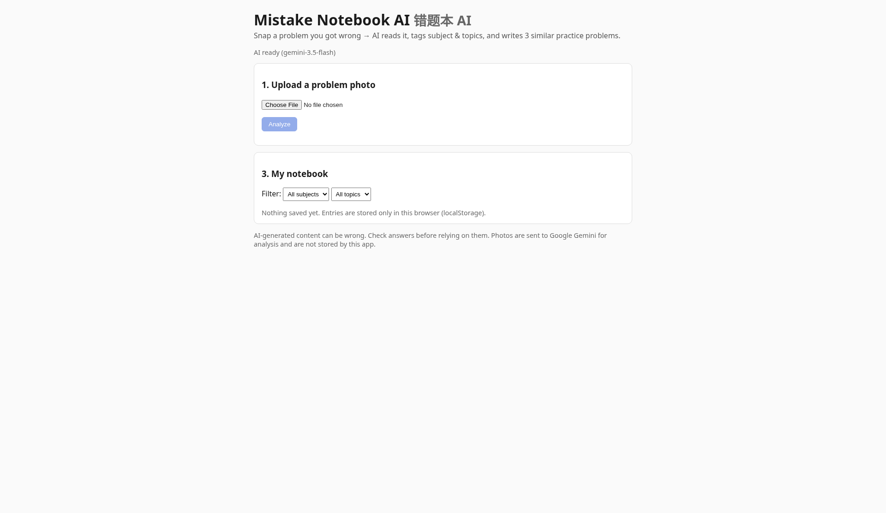
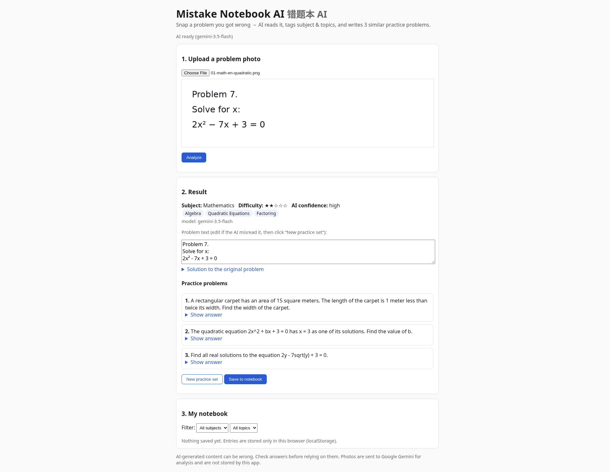
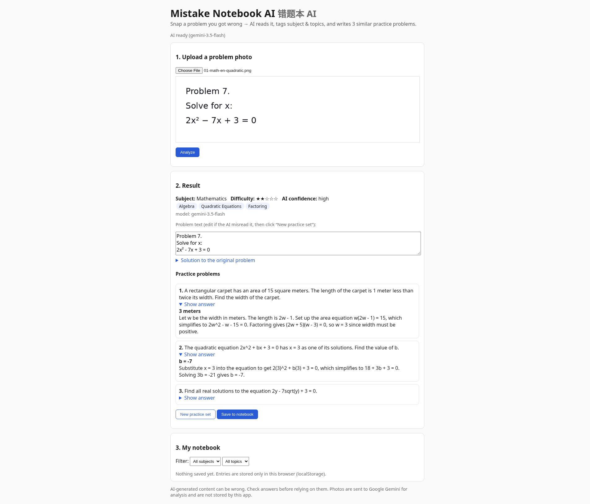
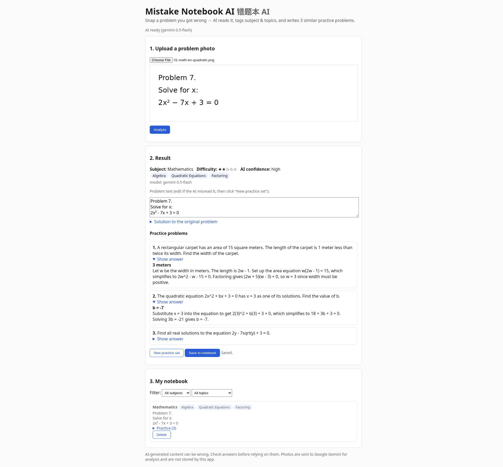

# Mistake Notebook AI (错题本 AI)

Snap a photo of a problem you got wrong. Gemini reads it, tags the subject, topics and difficulty, writes a short solution,
and generates **3 similar practice problems** (answers hidden until you click). Save entries to a notebook in your browser
and filter them by subject or topic. Works for any subject and answers in the problem's language (e.g. Chinese or English).

Built for [Next Byte Hacks V5](https://next-byte-hacks-v5.devpost.com/). This project was created during the hackathon;
the first commit is dated 2026-11-02.

- **Live demo:** https://mistake-notebook-ai.onrender.com (Render free tier: the first request after idle can take ~30-60 s to wake up; each AI analysis then takes roughly 15-50 s)
- **Demo video:** coming soon

## Features
1. Upload a JPG, PNG or WebP photo (max 5 MB).
2. AI analysis: transcribed problem text, subject, 1-5 topic tags, difficulty (1-5 stars), AI confidence, short solution.
3. Three practice problems on the same concept, each with an answer and explanation (collapsed by default).
4. Edit the problem text if the AI misread it, then click **New practice set** to regenerate practice from your corrected text.
5. **My notebook:** save entries, filter by subject or topic, delete. Stored only in your browser (`localStorage`); there is no account or server database.
6. Clear errors: missing API key, unreadable image, rate limit and AI failures are shown as messages. The app never shows mock data.

## Screenshots

Upload page:



Analysis result for a sample quadratic equation (subject, topic tags, difficulty stars, AI confidence, editable problem text):



Hovering the difficulty stars shows the AI's reason for the rating. Example from this run: "This is a routine 2-step exercise involving factoring a quadratic equation and solving for x." (This is a native browser tooltip, so it is not shown in the screenshots.)

Three practice problems, with answers revealed by clicking "Show answer":



Entry saved to the notebook (stored only in this browser):



## How it works
- `server.js`: tiny Node.js HTTP server (no npm dependencies). Endpoints: `GET /api/status`, `POST /api/analyze`, `POST /api/practice`.
- `lib/gemini.js`: Gemini REST client with structured JSON output (`responseJsonSchema`), retry with backoff on 429/500/503, and model fallback (`GEMINI_MODEL`, then `GEMINI_FALLBACK_MODELS`). The model that answered is shown in the UI.
- `lib/notebook.js`: prompts, JSON schemas, input validation and output normalization.
- `public/`: plain HTML + JavaScript front end.
- Photos are sent to the Gemini API in memory and are not stored by this app.
- Abuse protection: at most 10 AI calls per minute and `AI_MAX_REQUESTS` (default 200) per server run.

## Run locally
Requires Node.js 20+.
```bash
cp .env.example .env      # then put your own key in GEMINI_API_KEY
npm test                  # 9 unit tests, mocked HTTP (no real API calls)
npm start                 # http://localhost:3000
```
Get a Gemini API key at [Google AI Studio](https://aistudio.google.com/apikey). Keys are read only from environment variables or `.env` (git-ignored) and are never logged.

| Variable | Required | Default |
|---|---|---|
| `GEMINI_API_KEY` | yes | none |
| `GEMINI_MODEL` | no | `gemini-3.5-flash` |
| `GEMINI_FALLBACK_MODELS` | no | `gemini-3.5-flash-lite` |
| `AI_MAX_REQUESTS` | no | `200` |
| `PORT` | no | `3000` |

## Deploy to Render
`render.yaml` defines a free Node web service. Set `GEMINI_API_KEY` in the Render dashboard; it is never stored in the repo.

## Test images
`samples/` contains 7 test images we rendered ourselves (math in English and Chinese, physics, chemistry, English grammar,
a blurred and rotated Chinese biology "phone photo", and a blank image). See [`samples/SOURCES.md`](samples/SOURCES.md).

## Tested end-to-end (real Gemini calls, 2026-11-02, local)
All 6 problem images were transcribed correctly and got a sensible subject and topics; the blank image was rejected with
a clear "could not read a problem" message. We checked every original solution and every practice answer by hand in this run and
found no wrong answers. One finding: an early version of our grammar test image had its text cut off at the image edge; the AI
transcribed only the visible part and did not invent the missing words. Response times were about 15-50 s per request.
This is a small hand-made test set, not a benchmark; real handwritten or crowded photos may do worse.

## AI tools used
- **Google Gemini API**: the core feature (reading the photo, classifying, writing practice problems).
- **AI coding assistant**: helped write and review code and documentation. The idea, scope and testing decisions are the author's.

## Limitations
- AI answers can be wrong; always check them. The UI warns when AI confidence is low.
- Only one problem per photo works best. Handwriting and complex diagrams were not tested.
- Math is shown as plain text (no LaTeX rendering yet).
- The notebook lives in one browser; clearing site data deletes it.

## License
MIT. See [LICENSE](LICENSE).
